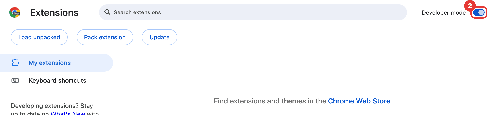
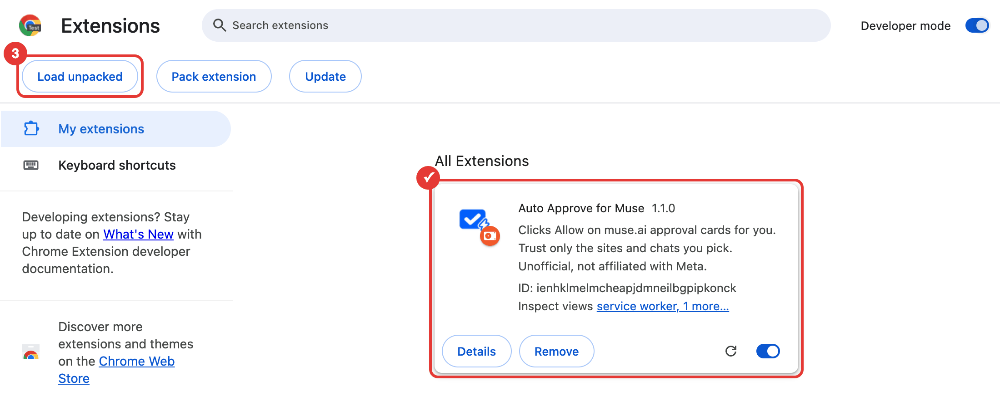
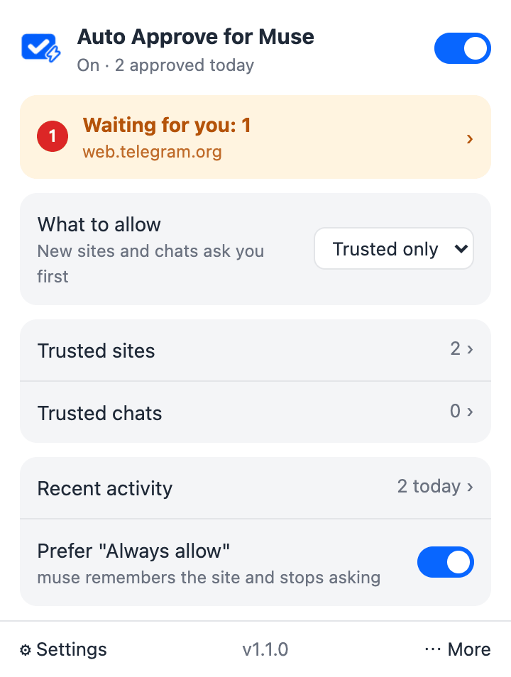
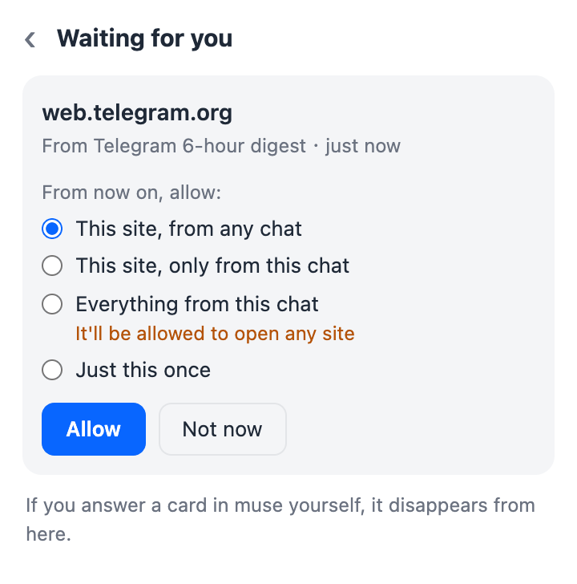
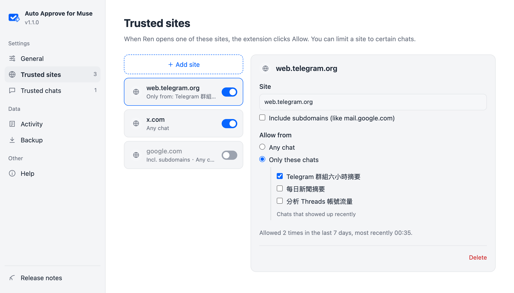

<p align="center">
  
</p>

<h1 align="center">Auto Approve for Muse</h1>

<p align="center">
  <a href="https://chromewebstore.google.com/detail/hbcimibdadjhancbpjibbhnhlcflmoii"></a>
</p>

<p align="center"><a href="README.md">English</a> · <a href="README.zh-TW.md">繁體中文</a> · 日本語</p>

muse.ai のアシスタントが新しいサイトや重要なサイトを開こうとすると、承認カードが表示され、「許可」を押すまで待ちます。誰も操作しないとタスクはそのまま止まってしまい、スケジュールタスクでは特に頻繁に起こります。

この Chrome 拡張機能が代わりに「許可」を押します。すべてを許可することも、信頼したサイト・アクション・チャットだけを許可することもできます。カードに「常に許可」があればそちらを選ぶので、同じサイトで何度も確認されません。

> 非公式ツールです。Meta や muse.ai とは関係ありません。自動許可はアシスタントがアクセスできるものに対する人の確認を省くため、リスクを理解したうえで使用してください。

## インストール

[Chrome ウェブストア](https://chromewebstore.google.com/detail/hbcimibdadjhancbpjibbhnhlcflmoii)からインストールしてください。ストア版は自動で更新されます。

ストアを使わずに、このリポジトリからインストールすることもできます。下のインストールスクリプトか手動インストールのどちらか一方を使ってください。両方入れると同じページで2つのコピーが動きます。

### インストールスクリプト

macOS / Linux:

```bash
curl -fsSL https://raw.githubusercontent.com/homieyangg/muse-auto-approve/main/install.sh | bash
```

Windows (PowerShell):

```powershell
irm https://raw.githubusercontent.com/homieyangg/muse-auto-approve/main/install.ps1 | iex
```

スクリプトは最新リリースを `~/muse-auto-approve`（Windows では `%USERPROFILE%\muse-auto-approve`）にダウンロードし、`chrome://extensions` を開いてフォルダーのパスをクリップボードにコピーします。Chrome はスクリプトから拡張機能を直接インストールできないため、下の手動インストールの手順2と3は必要です。フォルダー選択が開いたら、参照する代わりにパスを貼り付けてください。

同じコマンドをもう一度実行すると更新できます。フォルダーは同じなので設定は保持されます。更新後は `chrome://extensions` の拡張機能カードの再読み込みアイコンを押してください。

### 手動インストール

1. このリポジトリを clone するか、ZIP をダウンロードして展開します。
2. `chrome://extensions` を開き、右上のデベロッパーモードをオンにします。

   

3. 「パッケージ化されていない拡張機能を読み込む」を押し、`manifest.json` があるフォルダーを選びます。Auto Approve for Muse が一覧に表示されます。

   

4. 開いている muse.ai のタブを再読み込みし、ツールバーの拡張機能アイコンを押してオンになっていることを確認します。アイコンがツールバーにない場合は、パズルピースのアイコンからピン留めしてください。

   

画面は英語・繁体字中国語・日本語に対応し、既定ではブラウザの言語に従います。設定ページで変更できます。

## 信頼するサイトとチャット

インストール後、ウェルカムページで動かし方を選びます。「信頼したものだけ」がおすすめです。「すべて許可」はバージョン 1.0 のようにすべてのカードを押します。1.0 から更新した場合は、変更するまで「すべて許可」のままです。

「信頼したものだけ」では、まだ信頼していないサイトのカードはそのまま残り、ツールバーのアイコンに赤い数字が表示されます。ポップアップを開いてリクエストを選び、どこまで信頼するかを決めます。



- このサイトを、すべてのチャットから
- このサイトを、このチャットからのみ
- このチャットのすべて。投稿やメッセージも含め、そのチャットが求めるものはすべて許可されます（購入・決済は除く）。確実なスケジュールタスクにだけ使ってください。
- 今回だけ。何も記憶しません

カードはすぐに押され、以後は条件に合うカードが確認なしで許可されます。信頼したチャットからのカード、またはサイト・アクションが信頼されていて、チャット制限がないか、制限されたチャットの1つからのカードが許可されます。

カードによってはウェブサイトを開くものではなく、Threads への投稿やメッセージ送信など、Ren に何かを依頼するものがあります。その場合はポップアップに「このサイト」ではなく「このアクション」が表示されます。拡張機能は muse がアクションに付ける権限種別（Gmail の送信など）を記憶するため、単体のカードでも複数の承認をまとめたカードでも同じアクションとして認識します。「すべて許可」は、設定 > 一般 > 詳細設定の「アクションを含める」をオンにしない限り、アクションカードを押しません。投稿やメッセージは取り消せないためです。

ブラウザのアップロードカード（「Ren にブラウザでこのファイルをアップロードさせますか？」）は、muse ではアップロード先のサイトに紐づきます。そのため拡張機能はそのサイトへのリクエストとして扱います。「すべて許可」では承認し、「このサイトへのアップロードを常に許可」を選びます。「信頼したものだけ」ではポップアップに「tumblr.com へのアップロード」と表示され、信頼してもそのサイトへのアップロードだけが対象です。サイトの閲覧を信頼しても、そのサイトへのアップロードは対象になりません。

サイトによってはアカウントごとにサブドメインが割り当てられます。たとえば Workday の求人応募は企業ごとに異なるホスト（`company.wd5.myworkdayjobs.com`）になるため、そのままでは毎回確認されます。設定 > アクションでアップロードルールのサイトを変更し、「サブドメインを含める」をオンにすると、`myworkdayjobs.com` の1つのルールで各社の Workday ホストへのアップロードをカバーできます。元のルールより広い範囲になるため、Ren にファイルをアップロードさせてよいサイトだけに使ってください。

チェックアウト・注文・購入のカードはお金を使うため、設定にかかわらず拡張機能が自動で許可することはありません。ポップアップでは「今回だけ」だけが選べます。

チャットを信頼するには、muse のサイドチャットから選びます。muse でチャット一覧を一度開けば名前を記憶するので、入力する必要はありません。

設定ページには完全なリストがあります。サイトを特定のチャットに限定したり、削除せずに一時的にオフにしたり、アクティビティログを確認したり、設定をエクスポート・インポートしたりできます。



## Muse 側の承認設定と権限

この拡張機能は muse の設定を変更しません。カードが自動で押されるかどうかは、muse 側の承認ポリシーにも左右されます。Muse の公式ヘルプ（日本語版）では、\[設定\] → \[アクセス許可\] で次のように設定できると説明されています。

- **コネクタ**: \[Ask for some actions\] は、すべての書き込みアクションと重要な読み取りアクションの前に許可を求めます。\[常に確認\] は、すべてのアクションの前に許可を求めます。
- **ウェブアクセスのデフォルト**: \[一部のアクションをリクエスト\] は、情報が共有される可能性があるときや見慣れないサイトへアクセスするときに許可を求めます。\[常に確認\] は、ウェブサイトへアクセスする前に許可を求めます。
- **アクセス許可の管理**: コネクターごとの権限、アーティファクトと日時指定タスク、許可したウェブサイトを個別に確認・取り消しできます。

Muse は読み取りアクション（カレンダーの確認、メールの読み取り、GitHub の issue 一覧取得など）と書き込みアクション（メッセージ送信、投稿、購入など）を区別し、設定に応じて重要な読み取りアクションでも承認を求めます。

GitHub コネクターの `List issues on GitHub` は読み取りアクションですが、Muse が承認カードを表示する場合、この拡張機能から見ると「アクションカード」です。つまりサイトを開くカードではないため、次の扱いになります。

- **「信頼したものだけ」**: ポップアップで「このアクション」を選ぶと、同じ権限種別のカードが自動で許可されます。
- **「すべて許可」**: アクションカードは既定では自動許可されません。「設定 → 一般 → 詳細設定」の「アクションを含める」をオンにすると許可されます。投稿やメッセージは取り消せないため、必要な場合だけオンにしてください。
- **購入・決済**: どの設定でも自動許可しません。

GitHub コネクターを使うには、先に Muse 側で GitHub を接続し、必要な読み取り権限を許可しておく必要があります。この拡張機能は OAuth の接続や権限付与は行いません。カードが自動で押されないときは、ポップアップに理由（アクションが対象外、購入カード、など）が表示されます。

## 承認カードの見つけ方

- muse は承認カードに `data-testid="hatch-inline-approval-card"` を付けます。拡張機能はその印があるカードの中の「許可」「常に許可」だけを押すので、ページの他の場所にある許可ボタンは押しません。
- muse がこの印を外した場合は、同じブロック内に拒否と許可のボタンがあり、カード本文がウェブサイト・アクセス・ブラウザ・権限・許可について言及しているときだけ押します。削除確認のような無関係なダイアログは対象外です。
- 「このメールを送信」のようなカードは、ボタン自体がアクション名（「送信」「送信しない」）になっています。拡張機能はボタンの文字ではなく、muse が付ける属性から主ボタンを見つけます。
- 複数の承認が1枚のカードにまとめられている場合（「Ren は続行するために承認が必要です」）は、1つずつ許可し、カードが描き直されるのを待ってから次を押します。
- muse ページ内の小さなスクリプトが、各カードの承認 ID、権限種別、アップロード先、保留中の承認一覧を読み取ります。これは muse ページがすでに持っているデータで、ブラウザ内に留まり、どこにも送信されません。承認 ID があるため、サイドパネルとチャットの両方に表示された承認を二重に押すことはありません。
- 別のチャットやスケジュールタスクからの承認は「確認」ボタン付きのバナーとしてのみ表示され、拡張機能が「確認」を押して開きます。現在のチャットに独自のカードが待機している場合、muse はそのバナーを隠します。画面にない承認がある場合、拡張機能は代わりにサイドパネルの承認タブを開きます。このタブは承認を1つずつ展開するため、下のほうにある信頼済みの承認が先に展開されてから許可されます。
- 「常に許可」が「その他の許可オプション」メニュー（サイドパネル、まとめカード）に隠れている場合、拡張機能はメニューを開いて押します。
- 同じカードを5秒以内に2回押すことはなく、「確認」は10秒に1回までです。開いたカードが信頼されていない場合、同じ承認の組を10分間放置し、何度も開き直しません。

メール、まとめ、サイドチャット、スケジュールタスク、ウェブサイトのカードは、繁体字中国語・英語・簡体字中国語の実サイトでテスト済みです。ブラウザのアップロードカードは繁体字中国語と日本語でテスト済みです。チェックアウトカードは実際には発生させておらず、muse の承認データにあるチェックアウト・支払いの項目で判定しています。言語には左右されず、補助的にカードの文言も照合します。日本語の「許可する」「許可しない」「承認しない」「一度だけ許可」「…を常に許可」などの文言は自動テストで確認しています。

## 制限

- muse.ai のタブを開いたままにする必要があります。閉じると何も許可されません。
- 「すべて許可」モードでは、すべてのウェブサイトカード（サイトへのブラウザアップロードを含む）を許可し、オンにしていればアクションカードも許可します。
- アクションは muse の権限種別で照合します。古いバージョンで保存したルールはカードのタイトルだけを持ち、次にそのカードが表示されたときに権限種別を補います。「Threads への投稿」を信頼すると、文章やアカウントにかかわらずすべての投稿が対象になります。
- タスクを開始したチャット内に表示されるカードは、どのチャットから来たかを示さないことが多く、「このチャットからのみ」の選択肢が出ません。
- muse.ai のデザイン変更で照合が壊れることがあります。ボタンの文言、確認バナーのマークアップ、ページから読み取る承認データが特に変更されやすい部分です。データがない場合はカード本文によるフォールバックになり、まとめカードや重複カードの扱いは弱くなります。

## 24時間動かす

パソコンを常時起動しない場合は、拡張機能を読み込んだ Chromium をサーバーで動かせます。`deploy/compose.yml` は [linuxserver/chromium](https://github.com/linuxserver/docker-chromium) を使い、amd64 と arm64 の両方で動作します。

```bash
cd deploy
docker compose up -d
```

Web UI から一度 muse.ai にサインインする必要があります。compose ファイルはサーバーの `127.0.0.1:13000` にバインドするため、SSH トンネル経由で接続します。

```bash
ssh -L 13000:127.0.0.1:13000 <your-server>
# その後 http://localhost:13000 を開く
```

サインインしたらページと SSH セッションを閉じてかまいません。Chromium はサーバー上で動き続け、ログイン状態は Docker ボリューム `muse-browser-config` に保存されます。

注意点:

- Web UI にはパスワードなしの sudo が使えるターミナルがあります。ポートをインターネットに公開しないでください。
- コンテナ内の Chromium は既定で英語になり、muse.ai はブラウザの言語に従います。compose は動作確認済みの UI に合わせて `--lang=zh-TW` を渡しています。サインイン後は Chromium の言語を日本語に変え、ページ翻訳をオフにしてください。翻訳されたページは拡張機能が探すボタンの文言を変えてしまいます。
- Web UI のストリーミングは CPU を多く使うため、使い終わったら閉じてください。
- サーバー上の Chromium は Google にサインインしていないため、信頼リストは同期されません。自分のブラウザの設定 > バックアップからエクスポートし、サーバーでインポートしてください。
- 拡張機能を更新したら `docker compose restart` を実行し、Chromium に新しいバージョンを読み込ませてください。

## プライバシー

拡張機能はサーバーを持たず、自分からネットワークリクエストを送りません。モードと信頼リストは `chrome.storage.sync` に保存され、同じ Google アカウントでサインインした Chrome 間で同期されます。アクティビティログは `chrome.storage.local` としてこのコンピューターに残ります。詳細は [PRIVACY.md](PRIVACY.md) を参照してください。

## テスト

```bash
node --test tests/*.test.js
```

英語・繁体字中国語・簡体字中国語・日本語の承認ボタン文言、チャット名と購入カードの判定、ロケールのキー一致、manifest のメッセージ長をテストします。

## パッケージング

```bash
./scripts/pack.sh
```

Chrome ウェブストア用の zip が `dist/` に出力されます。拡張機能に必要なファイルだけが含まれます。

## ライセンス

MIT
