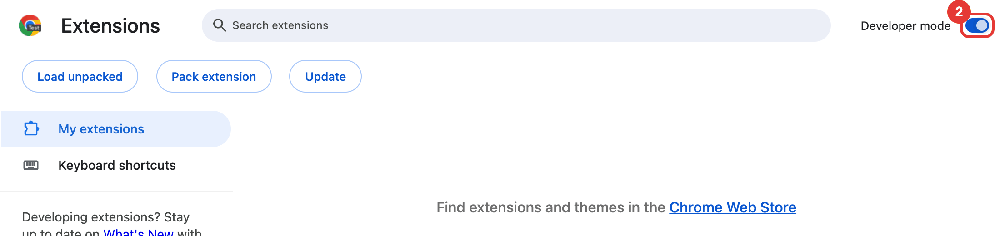
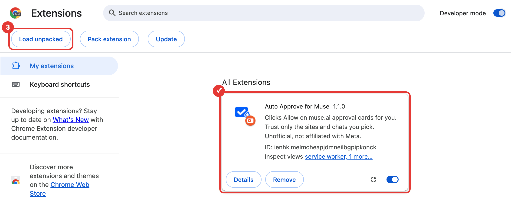
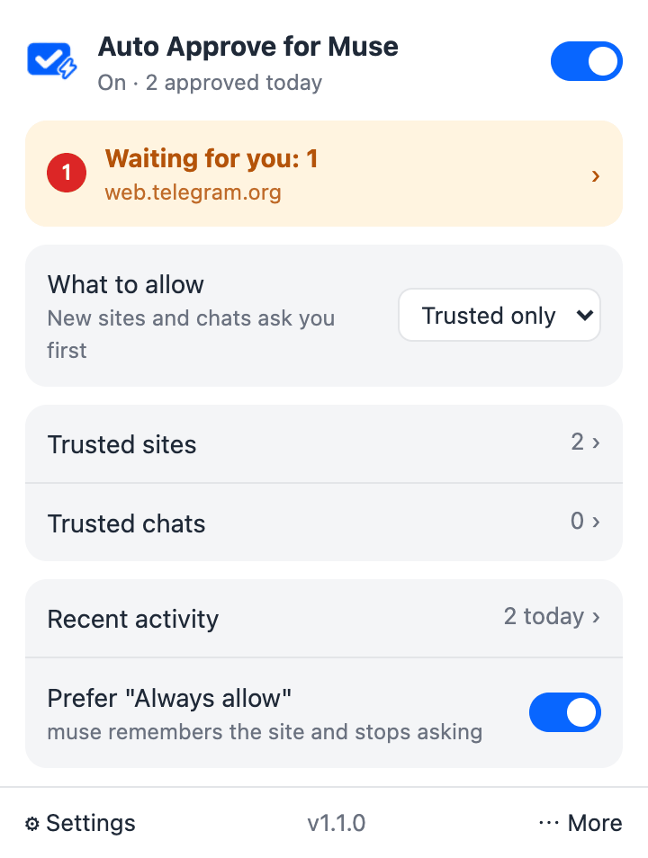
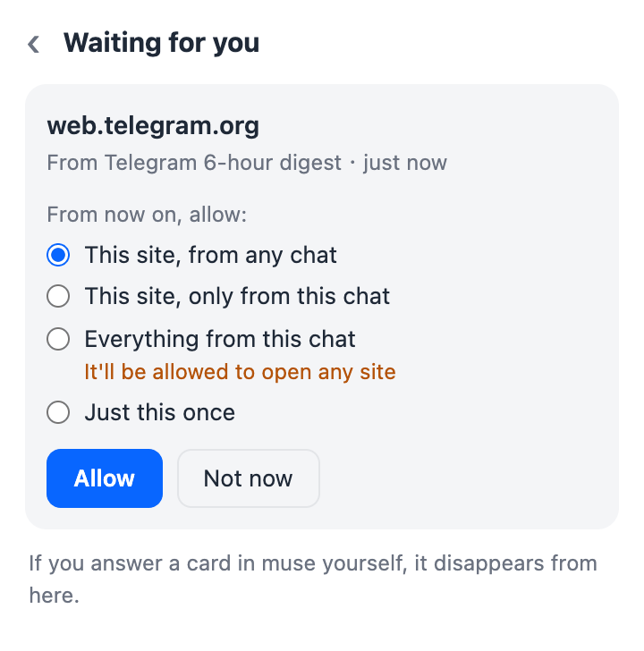
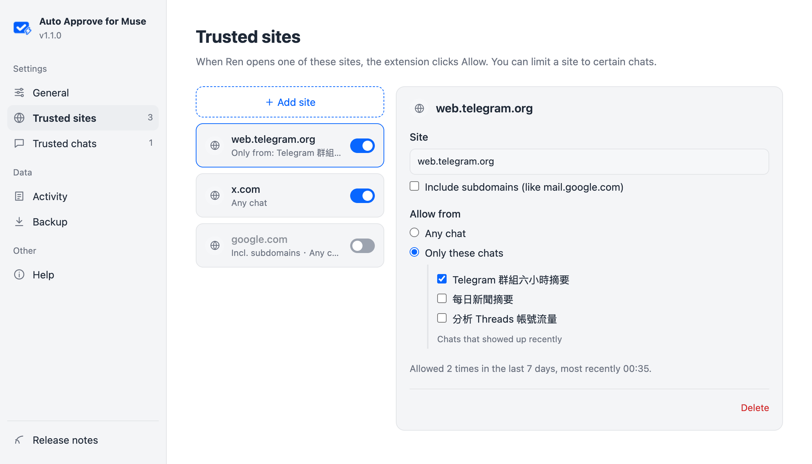

<p align="center">
  
</p>

<h1 align="center">Auto Approve for Muse</h1>

<p align="center">
  <a href="https://chromewebstore.google.com/detail/hbcimibdadjhancbpjibbhnhlcflmoii"></a>
</p>

<p align="center"><a href="README.zh-TW.md">繁體中文</a> · <a href="README.zh-CN.md">简体中文</a> · <a href="README.ja.md">日本語</a></p>

Auto Approve for Muse clicks Allow on muse.ai approval cards so tasks do not stall while you are away, scheduled tasks most of all. You can approve everything, or limit it to the sites, actions, and chats you trust.

When a card offers "Always allow", the extension picks that so the same site stops asking.

> Unofficial tool, not affiliated with Meta or muse.ai. Source code: https://github.com/homieyangg/muse-auto-approve. Auto-approving skips the human check on what the assistant can access, so make sure you are fine with that.

## Install

Install from the [Chrome Web Store](https://chromewebstore.google.com/detail/hbcimibdadjhancbpjibbhnhlcflmoii) for automatic updates.

If you prefer not to use the store, the script and manual steps below load the same extension from this repo. Pick one method. Installing both runs two copies on the same page.

### Install script

macOS / Linux:

```bash
curl -fsSL https://raw.githubusercontent.com/homieyangg/muse-auto-approve/main/install.sh | bash
```

Windows (PowerShell):

```powershell
irm https://raw.githubusercontent.com/homieyangg/muse-auto-approve/main/install.ps1 | iex
```

The script downloads the latest release to `~/muse-auto-approve` (`%USERPROFILE%\muse-auto-approve` on Windows), opens `chrome://extensions`, and copies the folder path to your clipboard. Chrome blocks scripts from installing extensions directly, so complete steps 2 and 3 below and paste the path into the folder picker.

Run the same command again to update. Your folder and settings stay intact. After updating, click the reload icon on the extension card in `chrome://extensions`.

### Manual install

1. Clone or download this repo. If you download the ZIP, unzip it first.
2. Open `chrome://extensions` and turn on Developer mode in the top right corner.

   

3. Click "Load unpacked" and select the folder containing `manifest.json`. Auto Approve for Muse will appear in the list.

   

4. Reload any open muse.ai tabs, then click the toolbar icon to verify it is on. If it is hidden, open the puzzle piece icon and pin it.

   

The interface supports English, Traditional Chinese, Simplified Chinese, and Japanese, following your browser language by default (changeable in Settings). Approval cards on English, Traditional Chinese, and Japanese muse.ai accounts are supported.

## Modes and trusted rules

After install, a welcome page asks which mode to use:

- **Only what I trust** (recommended): Unrecognized sites, actions, and chats wait for you.
- **Allow everything**: Approves every website card, matching version 1.0. Upgrading from 1.0 keeps this mode until you change it.

In "Only what I trust", a waiting card adds a red number to the toolbar icon. Open the popup, click the request, and choose how far to trust it:



- This site, from any chat
- This site, only from this chat
- Everything from this chat: approves every request from that chat, including posts and messages (except checkouts and purchases). Save this for scheduled tasks you are sure about.
- Just this once, without saving

The card is clicked immediately, and matching cards are approved automatically from then on. A card matches when it comes from a trusted chat, or when its site or action is trusted with either no chat limit or a matching chat limit.

**Action cards.** Some cards ask Ren to perform an action, such as posting to Threads or sending a message. The popup offers "This action" instead of "This site". The extension stores the permission type muse attaches to the action (for example, sending Gmail), so it matches both single and combined cards. "Allow everything" leaves action cards alone by default because posts and messages cannot be undone. To auto-approve them, turn on "Include actions" under Settings > General > Advanced.

**Browser upload cards.** Cards like "Allow Ren to use Browser to upload this file?" are tied by muse to a destination site, so the extension treats them per site. "Allow everything" approves them with "Always allow uploads to this site". In "Only what I trust", the popup shows "Upload to tumblr.com", and trusting it only covers uploads to that site. Browsing trust does not cover uploads.

Some services assign each account its own subdomain, such as Workday (`company.wd5.myworkdayjobs.com`). In Settings > Actions, you can edit an upload rule's site and enable "Include subdomains" so one `myworkdayjobs.com` rule covers every company's Workday host. That scope is broader, so only use it for sites you are comfortable uploading to.

**Checkouts and purchases.** Cards that spend money are never auto-approved, regardless of settings. The popup only offers "Just this once".

**Trust from recent activity.** In the popup's Recent activity and on the Activity page in Settings, the newest row of a website card that would still stop and ask has a "Trust" button. Pick "Any chat" or "Only <chat>" to save a rule for exactly that site. An existing rule is only reused when it matches the same site without subdomains; otherwise a new rule is added. Rows from an unknown chat only offer "Any chat". Action, upload, checkout and purchase rows don't get the button, and neither do rows that muse's own approval data doesn't mark as opening a website, including rows logged by earlier versions. "Undo" puts that rule back the way it was, until you trust another row or close the page.

**Trusted chats and Settings.** Open your muse side chat list once and the extension remembers the chat names, so you can pick a chat without typing. Settings holds the full lists: restrict a site to certain chats, disable entries without deleting them, view the activity log, and export or import your settings.



## Muse's own approval settings

The extension doesn't change Muse's settings. Whether a card appears at all depends on Muse's own approval policy. Meta's help center describes these controls under Settings > Access permissions:

- **Connectors**: "Ask for some actions" asks before every write action and important read actions. "Always ask" asks before every action.
- **Default web access**: "Ask for some actions" asks when information may be shared or an unfamiliar site is visited. "Always ask" asks before any website is opened.
- **Manage access permissions**: review or revoke per-connector permissions, approvals for artifacts and scheduled tasks, and the list of allowed websites.

Muse separates read actions (checking a calendar, reading email, listing GitHub issues) from write actions (sending a message, posting, buying). Depending on your settings, Muse may still ask for an important read action.

`List issues on GitHub` is a read action, but when Muse shows an approval card for it, the extension sees an action card rather than a website card. That means:

- **Only what I trust**: choose "This action" in the popup and cards with the same permission type are approved automatically.
- **Allow everything**: action cards are not approved by default. Turn on "Include actions" under Settings > General > Advanced. Posts and messages can't be undone, so only turn it on if you need it.
- **Checkout and purchase cards** are never approved automatically.

To use the GitHub connector, connect GitHub in Muse and grant the read permissions there first. The extension doesn't do OAuth or grant permissions. If a card isn't approved automatically, the popup says why (action not included, purchase card, and so on).

## What it clicks and what it skips

- muse marks approval cards with `data-testid="hatch-inline-approval-card"`. The extension only clicks Allow or Always allow inside a marked card, leaving Allow buttons elsewhere on the page alone.
- If that marker is ever removed, it falls back to finding Deny and Allow buttons in the same block, and only when the card text mentions a website, access, the browser, or permissions. Unrelated dialogs like delete confirmations are ignored.
- Buttons on approval cards in the chat are identified from muse's approval data, not their text, so they work in any language. Always allow is only clicked when it covers one site, or is muse's plain always-allow option. Wider options, such as every action of a connector or all web access for a task, are never picked; the extension clicks Allow once instead, or nothing if there is no such button.
- When a chat card's options are read but a button can't be matched to them (for example, it belongs to another approval), the extension only clicks the Allow once button the data confirms, never Always allow. Without that button it clicks nothing and lists the card as waiting. Once the data is read, "Just this once" or turning the Prefer "Always allow" setting off never clicks Always allow. Cards in the side panel, and cards whose approval data can't be read, are matched by button text as before; action-labeled buttons (such as "Send" and "Don't send") are then matched by the attribute muse sets on the primary button.
- Combined cards ("Ren needs approval to continue") are approved one item at a time, waiting for the card to redraw between clicks.
- A small in-page script reads each card's approval ID, permission type, upload destination, the approval's host field, button options, and the list of pending approvals from data already loaded on the muse page. Nothing leaves your browser. Approval IDs prevent clicking the same approval twice when it appears in both the side panel and the chat.
- Approvals from another chat or a scheduled task appear as a banner with a Review button, which the extension clicks to open them. If the current chat has its own card waiting, muse hides that banner; when the extension sees pending approvals off-screen, it opens the Approvals tab in the side panel and expands matching items to approve them.
- When "Always allow" sits inside the "More allow options" menu (side panel or combined cards), the extension opens the menu to click it. A chat card read from approval data never opens the menu; it clicks Allow once instead.
- Cooldowns: it will not click the same card twice within 5 seconds, clicks Review at most once every 10 seconds, and leaves the same set of untrusted approvals alone for 10 minutes instead of reopening them repeatedly.

Email, combined, side chat, scheduled task, and website cards have been tested on the live site in Traditional Chinese, English, and Simplified Chinese. Browser upload cards have been tested in Traditional Chinese and Japanese. Checkout cards have not been triggered for real; they are recognized from the checkout and payment fields in muse's approval data, which does not depend on language, with the card wording as a fallback. Japanese labels such as "許可する", "許可しない", "承認しない", "一度だけ許可", and "...を常に許可" are covered by automated tests.

## Limitations

- A muse.ai tab must stay open. If you close it, nothing gets approved.
- "Allow everything" approves every website card, including browser uploads, plus action cards if you turn that option on.
- Actions match by muse's permission type. Rules saved by older versions only store the card title and pick up the permission type the next time that card appears. Trusting "post to Threads" covers every post, regardless of text or account.
- Cards shown inside the chat that started the task often do not state which chat they came from, so "only from this chat" is not offered for them.
- A muse.ai redesign can break matching, especially button labels, review banner markup, or page approval data. Without that data, it falls back to card text, which handles combined and duplicate cards less reliably.

## Running it around the clock

If your computer does not stay on, you can run Chromium with the extension loaded on a server. `deploy/compose.yml` uses [linuxserver/chromium](https://github.com/linuxserver/docker-chromium) and supports amd64 and arm64.

```bash
cd deploy
docker compose up -d
```

Sign in to muse.ai once through the web UI. The compose file binds it to `127.0.0.1:13000` on the server, so connect over an SSH tunnel:

```bash
ssh -L 13000:127.0.0.1:13000 <your-server>
# then open http://localhost:13000
```

Once signed in, close the page and the SSH session. Chromium keeps running on the server, and your login persists in the `muse-browser-config` Docker volume.

Keep in mind:

- The web UI includes a terminal with passwordless sudo. Never expose the port to the internet.
- Container Chromium defaults to English, and muse.ai follows the browser language. The compose file passes `--lang=zh-TW` because that UI was tested with the extension. After signing in, also set Chromium's language to the one you want (Traditional Chinese, English, or Japanese) and turn off page translation so translated labels do not break matching.
- Streaming the web UI uses noticeable CPU. Close it when you are done.
- Server Chromium is not signed in to Google, so trusted lists do not sync automatically. Export them from Settings > Backup in your local browser and import the file on the server.
- After updating the extension, run `docker compose restart` to load the new version.

## Privacy

The extension has no server and makes no network requests of its own. Your mode and trusted lists are stored in `chrome.storage.sync`, so Chrome syncs them between browsers signed in to the same Google account. The activity log stays in `chrome.storage.local` on your computer. See [PRIVACY.md](PRIVACY.md) for details.

## Testing

```bash
node --test tests/*.test.js
```

The tests cover approval-label matching in English, Traditional Chinese, Simplified Chinese, and Japanese, chat/purchase parsing, locale key parity, and the manifest message limits.

## Packaging

```bash
./scripts/pack.sh
```

This writes a Chrome Web Store zip to `dist/` containing only the files the extension needs.

## License

MIT
