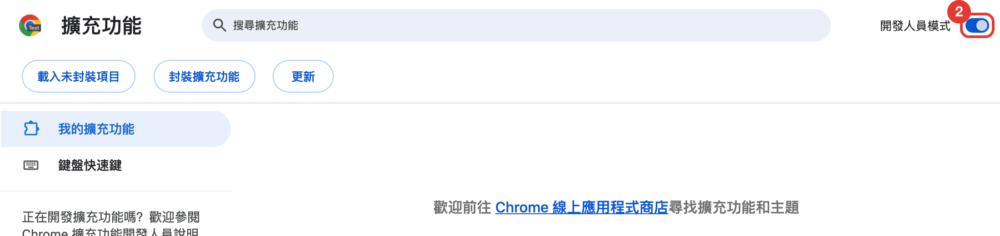
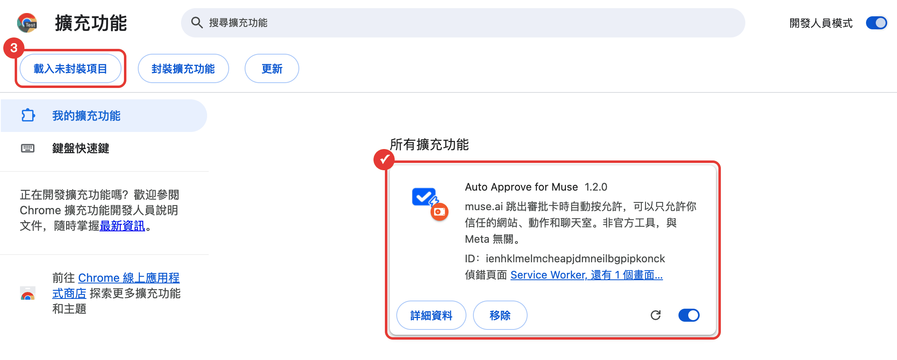
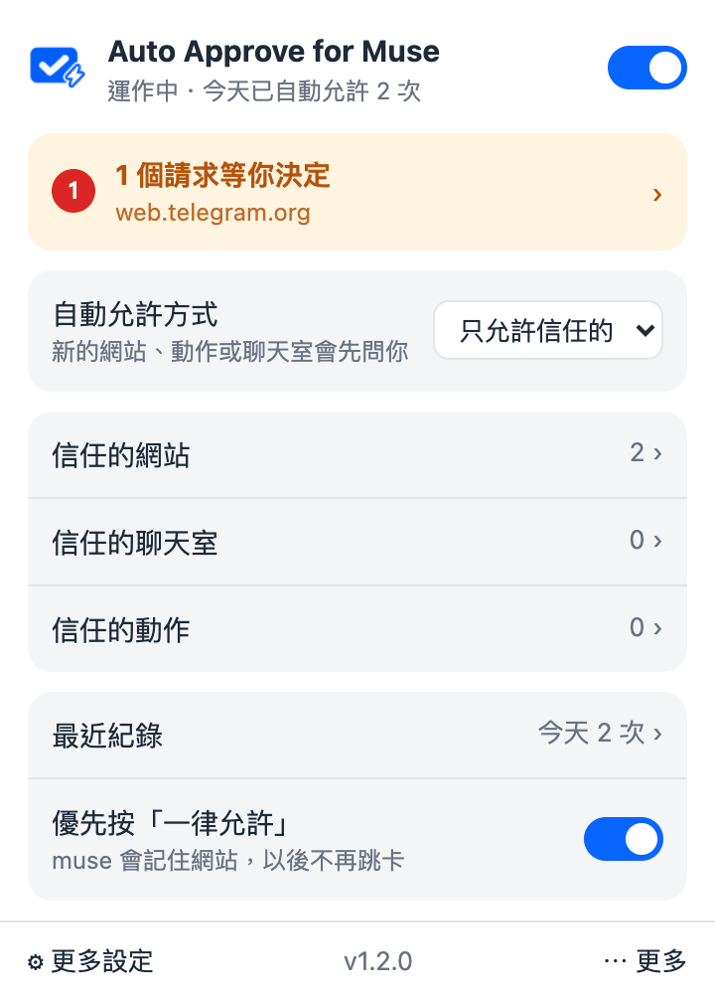
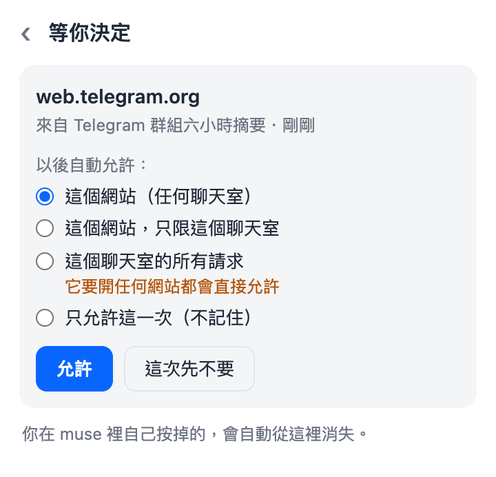
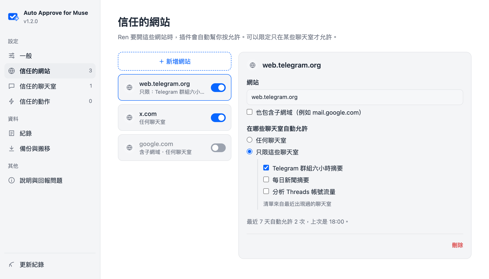

<p align="center">
  
</p>

<h1 align="center">Auto Approve for Muse</h1>

<p align="center">
  <a href="https://chromewebstore.google.com/detail/hbcimibdadjhancbpjibbhnhlcflmoii"></a>
</p>

<p align="center"><a href="README.md">English</a> · <a href="README.zh-TW.md">繁體中文</a> · <a href="README.ja.md">日本語</a></p>

muse.ai 弹出审批卡时，这个 Chrome 插件会自动帮你点击允许，人不在电脑前任务也不会卡住，跑定时任务时尤其明显。你可以让它全部自动点击，或只放行你信任的网站、操作和聊天。

卡片提供始终允许类的选项时会优先点击它，之后同一个网站就不会再问。

> 非官方工具，与 Meta、muse.ai 无关。源代码：https://github.com/homieyangg/muse-auto-approve 。自动允许相当于跳过人工确认，请自行评估风险。

## 安装

直接从 [Chrome 应用商店](https://chromewebstore.google.com/detail/hbcimibdadjhancbpjibbhnhlcflmoii) 安装，之后会自动更新。

不想用商店的话，下面的安装脚本和手动安装加载的是同一个插件，均来自本仓库。两种方式选一种即可，两个都装会在同一个页面运行两份。

### 安装脚本

macOS / Linux：

```bash
curl -fsSL https://raw.githubusercontent.com/homieyangg/muse-auto-approve/main/install.sh | bash
```

Windows（PowerShell）：

```powershell
irm https://raw.githubusercontent.com/homieyangg/muse-auto-approve/main/install.ps1 | iex
```

脚本会把最新版下载到 `~/muse-auto-approve`（Windows 为 `%USERPROFILE%\muse-auto-approve`），打开 `chrome://extensions`，并将文件夹路径复制到剪贴板。Chrome 不允许脚本自行安装插件，所以下面的步骤 2 和 3 仍需手动点击；弹出选择文件夹窗口时直接粘贴路径即可。

之后更新只需再运行一次同一条命令。文件夹位置不变，设置会保留，更新完记得在 `chrome://extensions` 点击插件卡片上的重新加载图标。

### 手动安装

1. 下载或 clone 本仓库。如果下载的是 ZIP 包，请先解压。
2. 在 Chrome 中打开 `chrome://extensions`，开启右上角「开发者模式」。

   

3. 点击「加载已解压的扩展程序」，选择包含 `manifest.json` 的文件夹。列表中就会出现 Auto Approve for Muse。

   

4. 刷新 muse.ai 标签页，点击工具栏上的插件图标确认已启用。没看到图标的话，点击拼图图标将其固定到工具栏。

   

界面支持简体中文、繁体中文、英文、日文，默认跟随浏览器语言，也可以在设置页切换。繁体中文、英文、日文账号的 muse.ai 审批卡均已支持。

## 模式与信任列表

装好后会弹出欢迎页让你选择模式：

- **只允许我信任的**（推荐）：尚未信任的网站、操作和聊天会先等你决定。
- **全部自动允许**：每张网站审批卡都直接点击，与 1.0 版一致。从 1.0 版升级上来会保留这个模式，需要手动修改才会变更。

选择「只允许我信任的」时，遇到尚未信任的请求，插件不会点击，工具栏图标上会出现红色数字。点开弹窗、点那条请求，选择要信任的范围：



- 这个网站（任何聊天）
- 这个网站，仅限这个聊天
- 这个聊天的所有请求：访问网站、发帖、发消息都会直接放行（结账、购买除外），只留给你非常确定的定时任务使用
- 只允许这一次，不记住

选好后那张卡片会立刻被点掉，之后符合条件的卡片就会自动允许。判断条件为：来自信任的聊天，或网站、操作在信任列表中且没有聊天限制（或正好来自限定的聊天）。

**操作卡。** 有些卡片是要 Ren 执行某个操作，例如发帖到 Threads、发送消息。这类卡片在弹窗里会显示「这个操作」，插件会记住 muse 标记的权限类型（例如 Gmail 发邮件），单张卡片和批量卡片都能识别。「全部自动允许」默认不会点击操作卡，因为帖子和消息发出去无法撤回；如果需要一并自动点击，可到「设置 → 通用 → 高级」开启「全部允许时也点操作卡」。请求这个任务整段网络访问的卡片（显示为「这个任务的网络访问（从 example.org）」）也算操作卡：信任这个操作、信任的聊天室，或「全部自动允许」加上「全部允许时也点操作卡」才会点击，网站规则不涵盖它，因为网址只是访问的起点。

**浏览器上传卡。** 像请求让 Ren 用浏览器上传文件这类卡片，muse 会限定上传的目标网站，插件也会按那个网站处理。「全部自动允许」会直接点击，并选择一律允许上传到该网站的选项；「只允许我信任的」会在弹窗中显示「上传到 tumblr.com」，信任后仅放行上传到该网站，浏览网站的信任不包含上传权限。

有些网站每个账号都有独立子域名，例如 Workday 求职申请每家公司网址不同（`company.wd5.myworkdayjobs.com`），每家都会重新询问。到「设置 → 操作」修改上传规则的网站并勾选「也包含子域名」，一条 `myworkdayjobs.com` 规则就能覆盖所有公司的 Workday。权限范围会扩大，只对你放心让 Ren 上传的网站开启。

**结账与购买卡。** 涉及花钱的卡片无论怎么设置都不会自动点击，弹窗里也只提供「只允许这一次」。

**信任聊天与设置页。** 在 muse 打开左侧的子聊天列表一次，插件就会记下名称，挑选聊天时不用手动输入。设置页提供完整列表，可以把网站限定在特定聊天、先停用而不删除、查看记录，也支持导出和导入设置。



## 如何识别审批卡、哪些不会点击

- muse 会给审批卡加上 `data-testid="hatch-inline-approval-card"`，插件只在带标记的卡片里点击始终允许类或允许类的按钮，不会误点卡片外的按钮。
- 如果 muse 移除了这个标记，会回退到旧判断：同一区域内同时存在拒绝类和允许类的按钮，且文字提到网站、访问、浏览器、权限才会点击，删除确认这类弹窗不会动。
- 聊天中的审批卡片，按钮通过 muse 的审批数据识别，不看按钮文字，所以任何语言都适用。始终允许类的选项只在范围是单个网站，或是 muse 普通的始终允许选项时才会点击。范围更大的选项，例如连接器的所有操作、本任务的所有网络访问，一律不选，改点仅允许一次的按钮，没有这个按钮就不点。
- 读得到选项、但有按钮和数据对不上时（例如按钮属于其他审批），只点击数据确认过的仅允许一次的按钮，不点始终允许类的按钮；没有这个按钮就不点，卡片留给你决定。读到数据后，选择「只允许这一次」或关闭「优先点击始终允许类的选项」时不会改点始终允许类的按钮。右侧面板的卡片，以及读不到审批数据的卡片，照旧看按钮文字。发邮件这类卡片的按钮写的是操作本身，插件识别 muse 标在主按钮上的属性，不依赖按钮文字。
- 多项请求合并成一张卡片时，插件会逐项点击，每点完一项等卡片重绘后再点下一项。
- 页面内有一段小脚本读取每张卡片的审批 ID、权限类型、上传目标网站、按钮选项和待审列表。这些数据本来就在 muse 页面上，只在浏览器本地使用，不会向外发送。依靠审批 ID，同时出现在右侧面板和聊天中的同一条审批只会点击一次。
- 审批来自其他聊天或定时任务时，页面只显示一条审阅提示，插件会先点击提示上的按钮把卡片展开。如果当前聊天也有卡片在等待，muse 会隐藏这条提示；插件检测到页面上看不到待审项时，会改开右侧面板的批准页，把排在后面的信任项目展开再点。
- 始终允许类的选项收在附加选项菜单里时（右侧面板、批量卡），插件会先打开菜单再点。聊天中读到审批数据的卡片不打开菜单，改点仅允许一次的按钮。
- 防重复机制：同一张卡片 5 秒内不重复点击，审阅提示最多 10 秒点一次。展开的卡片如果不在信任列表中，同一批审批 10 分钟内不会反复点开。

繁体中文、英文、简体中文界面都实测过发邮件、批量、子聊天、定时任务、网站访问这几种卡片。浏览器上传卡在繁体中文界面实测过。结账卡没有实际触发过，是通过 muse 审批数据中的结账、付款字段判断，不受语言影响，同时也会比对卡片文字作为后备判断。日文账号的审批卡同样支持，「許可する」「許可しない」「常に許可」等按钮文字均有自动化测试覆盖。

## 限制

- muse.ai 标签页必须保持打开才能生效，关闭后不会工作。
- 「全部自动允许」会自动点击网站访问和浏览器上传卡；操作卡需要另外打开开关才会点击。
- 操作按 muse 的权限类型匹配。旧版按标题保存的规则，下次遇到同类卡片会自动补上权限类型。信任发帖到 Threads 这类操作后，无论内容或账号都会自动允许。
- 在发起任务的聊天里直接弹出的卡片通常没有标注来源聊天，因此不会提供「仅限这个聊天」选项。
- muse 改版可能导致识别失效，最容易受影响的是按钮文字、审阅提示的结构以及从页面读取的审批数据。读不到数据时会回退到只看卡片文字，批量卡和重复卡的处理效果会变差。聊天卡片持续无法读取数据时，弹窗会显示提示并附上反馈链接。

## 让它 24 小时运行

电脑会关机的话，可以在自己的服务器上常驻 Chromium 并加载插件。`deploy/compose.yml` 使用 [linuxserver/chromium](https://github.com/linuxserver/docker-chromium)，支持 amd64 和 arm64。

```bash
cd deploy
docker compose up -d
```

首次运行需要通过网页界面登录 muse.ai。compose 只把界面绑定在服务器的 `127.0.0.1:13000`，从本地建立 SSH 隧道连接：

```bash
ssh -L 13000:127.0.0.1:13000 <your-server>
# 浏览器打开 http://localhost:13000
```

登录后关闭网页、断开 SSH 都没关系，Chromium 会继续在服务器上运行，登录状态保存在 docker volume `muse-browser-config` 中。

需要注意几点：

- 网页界面内置免密码 sudo 的终端，绝对不要把端口对外暴露。
- 容器里的 Chromium 默认是英文，muse 会跟着变成英文界面。compose 已加上 `--lang=zh-TW`，首次登录后建议到 Chromium 设置里改成繁体中文并关闭网页翻译，免得按钮文字被翻译后无法识别。
- 网页界面开着会持续推流画面、占用不少 CPU，登录完就关掉。
- 服务器上的 Chromium 没有登录 Google，信任列表不会自动同步。先在本地浏览器的「设置 → 备份与迁移」导出，再到服务器导入。
- 更新插件后需要运行 `docker compose restart`，Chromium 才会加载新版本。

## 隐私

插件没有服务器，本身不会发起任何网络请求。模式和信任列表保存在 `chrome.storage.sync`，登录同一个 Google 账号的 Chrome 会通过 Chrome 同步；记录只保存在本机的 `chrome.storage.local`。详见 [PRIVACY.md](PRIVACY.md)。

## 打包

```bash
./scripts/pack.sh
```

会在 `dist/` 生成上架用的 zip 包，只包含插件运行所需的文件。

## License

MIT
