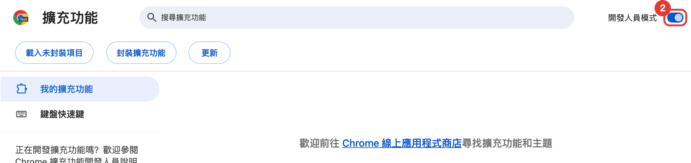
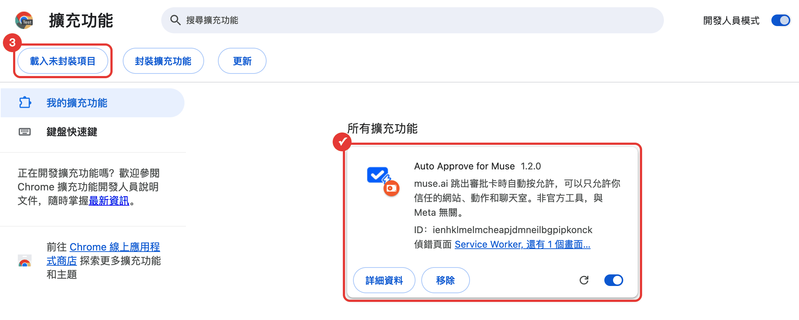
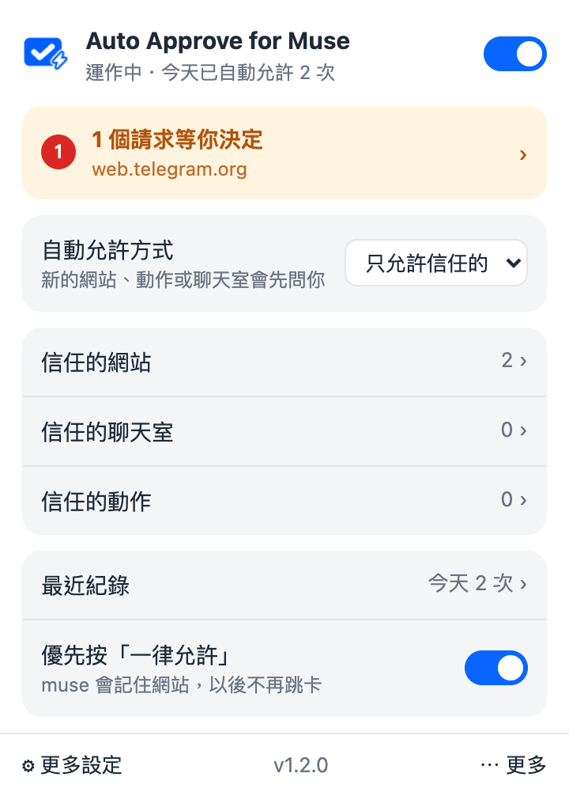
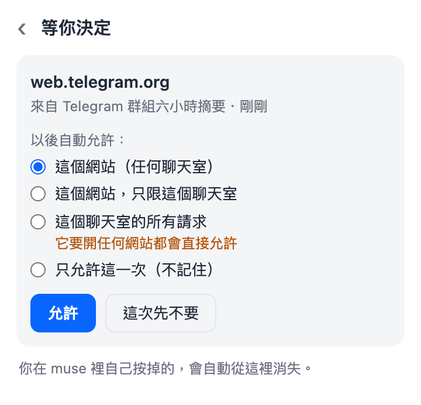
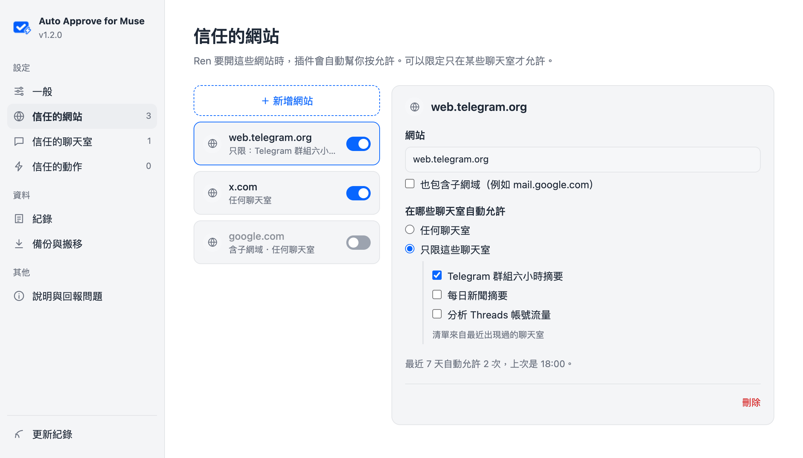

<p align="center">
  
</p>

<h1 align="center">Auto Approve for Muse</h1>

<p align="center">
  <a href="https://chromewebstore.google.com/detail/hbcimibdadjhancbpjibbhnhlcflmoii"></a>
</p>

<p align="center"><a href="README.md">English</a> · <a href="README.zh-CN.md">简体中文</a> · <a href="README.ja.md">日本語</a></p>

muse.ai 跳出審批卡時，這個 Chrome 插件會自動幫你按「允許」，人不在電腦前任務也不會卡住，跑排程特別有感。你可以讓它全部自動按，或只放行你信任的網站、動作和聊天室。

卡片有「一律允許」時會優先按它，之後同一個網站就不會再問。

> 非官方工具，與 Meta、muse.ai 無關。原始碼：https://github.com/homieyangg/muse-auto-approve 。自動允許等於跳過人工確認，請自行評估風險。

## 安裝

直接從 [Chrome 線上應用程式商店](https://chromewebstore.google.com/detail/hbcimibdadjhancbpjibbhnhlcflmoii) 安裝，之後會自動更新。

不想用商店的話，下面的安裝腳本跟手動安裝載入的是同一個插件，從這個 repo 來。兩種擇一就好，兩個都裝會在同一個頁面跑兩份。

### 安裝腳本

macOS / Linux：

```bash
curl -fsSL https://raw.githubusercontent.com/homieyangg/muse-auto-approve/main/install.sh | bash
```

Windows（PowerShell）：

```powershell
irm https://raw.githubusercontent.com/homieyangg/muse-auto-approve/main/install.ps1 | iex
```

腳本會把最新版下載到 `~/muse-auto-approve`（Windows 是 `%USERPROFILE%\muse-auto-approve`），打開 `chrome://extensions`，並把資料夾路徑複製到剪貼簿。Chrome 不允許腳本自己安裝插件，所以下面的步驟 2 和 3 還是要手動按；跳出選資料夾視窗時直接貼上路徑就好。

之後更新再跑一次同一個指令即可。資料夾位置不變，設定會保留，更新完記得在 `chrome://extensions` 按一下插件卡片的重新載入圖示。

### 手動安裝

1. 下載或 clone 這個 repo。下載 ZIP 的話先解壓縮。
2. Chrome 開 `chrome://extensions`，打開右上角「開發人員模式」。

   

3. 按「載入未封裝項目」，選包含 `manifest.json` 的資料夾。清單裡就會出現 Auto Approve for Muse。

   

4. 重新整理 muse.ai 分頁，點工具列的插件圖示確認有啟用。沒看到圖示的話，點拼圖圖示釘選出來。

   

介面支援繁體中文、簡體中文、英文、日文，預設跟著瀏覽器語言，也可以在設定頁切換。繁體中文、英文、日文帳號的 muse.ai 審批卡都有支援。

## 模式與信任清單

裝好後會跳出歡迎頁讓你選模式：

- **只允許我信任的**（推薦）：還沒信任過的網站、動作和聊天室會先等你決定。
- **全部自動允許**：每張網站審批卡都直接按，跟 1.0 版一樣。從 1.0 版更新上來會維持這個模式，要自己去改才會變。

選「只允許我信任的」時，遇到還沒信任的請求，插件不會按，工具列圖示會出現紅色數字。點開 popup、點那筆請求，選要信任到什麼範圍：



- 這個網站（任何聊天室）
- 這個網站，只限這個聊天室
- 這個聊天室的所有請求：開網站、發文、傳訊息都會直接放行（結帳、購買除外），只留給你很確定的排程用
- 只允許這一次，不記住

選好後那張卡會立刻被按掉，之後符合的卡就自動允許。判斷條件是：來自信任的聊天室，或網站、動作在信任清單裡且沒有聊天室限制（或正好來自限定的聊天室）。

聊天室裡的審批卡，muse 的審批資料有寫來源聊天室或排程時，從這張卡信任的聊天室會連同 ID 一起存。這種項目只認 ID：聊天室改名後照樣符合，另一個同名的聊天室則不算。舊版存的項目，以及讀不到 ID 的卡，照舊比對聊天室名稱。設定維持舊版讀得懂的格式，ID 存在舊版不讀的欄位。舊版讀到同一份設定時，網站和動作的聊天室限制照名稱比對，連同 ID 存的信任聊天室則完全不信任。

**動作卡。** 有些卡是要 Ren 做一個動作，例如發文到 Threads、傳訊息。這種卡在 popup 會顯示「這個動作」，插件記住 muse 標記的權限種類（例如 Gmail 寄信），單張卡和批次卡都認得。「全部自動允許」預設不會按動作卡，因為文章和訊息發出去收不回來；要一起按的話，到「設定 → 一般 → 進階」打開「全部允許時也按動作卡」。

**瀏覽器上傳卡。** 像「允許 Ren 使用 Browser 上傳此檔案？」這類卡片，muse 會限定上傳的目的網站，插件就照那個網站處理。「全部自動允許」會直接按並選「Always allow uploads to this site」；「只允許我信任的」會在 popup 顯示「上傳到 tumblr.com」，信任後只放行上傳到這個網站，瀏覽網站的信任不包含上傳。

有些網站每個帳號各有子網域，例如 Workday 求職申請每家公司網址不同（`company.wd5.myworkdayjobs.com`），每家都會重問。到「設定 → 動作」改掉上傳規則的網站並勾選「也包含子網域」，一條 `myworkdayjobs.com` 規則就能涵蓋所有公司的 Workday。範圍變大，只對你放心讓 Ren 上傳的網站開。

**結帳與購買卡。** 會花到錢的卡片不管怎麼設定都不會自動按，popup 裡也只有「只允許這一次」。

**信任聊天室與設定頁。** 在 muse 打開左邊的副聊天室清單一次，插件就會記下名稱，挑聊天室不用自己打字。設定頁有完整清單，可以把網站限定在特定聊天室、先停用不刪掉、看紀錄，也能匯出匯入設定。



## 怎麼找審批卡、哪些不會按

- muse 會替審批卡加上 `data-testid="hatch-inline-approval-card"`，插件只在標記的卡片裡按「一律允許」或「允許」，卡片外的按鈕不會被點到。
- 萬一 muse 拿掉這個標記，會退回舊判斷：同一區塊裡同時有「拒絕」和「允許」，且文字提到網站、存取、瀏覽器、權限才會按，刪除確認這類對話框不會動。
- 聊天室裡的審批卡，按鈕從 muse 的審批資料辨識，不看按鈕文字，所以任何語言都適用。「一律允許」只在範圍是單一網站，或是 muse 一般的一律允許選項時才會按。範圍更大的選項，例如連接器的所有動作、這個任務的所有網路存取，一律不選，改按「允許一次」，沒有這顆按鈕就不按。
- 讀得到選項、但有按鈕對不上資料時（例如按鈕屬於別筆審批），只按資料確認過的「允許一次」，不按「一律允許」；沒有這顆按鈕就不按，卡片列在等你決定。讀到資料後，選「只允許這一次」或關掉「優先按「一律允許」」時不會改按「一律允許」。右側面板的卡片，以及讀不到審批資料的卡片，照舊看按鈕文字。寄信這類按鈕寫的是動作本身（「傳送」「不要傳送」），這時插件認 muse 標在主要按鈕上的屬性。
- 好幾項合併成一張卡時（「Ren需要獲得批准才能繼續」），插件會逐項點擊，每按一項等卡片重畫完再按下一項。
- 頁面內有一支小腳本讀取每張卡的審批 ID、權限種類、上傳目的網站、按鈕選項、來源聊天室或排程的 ID、側邊欄聊天室的 ID 與待審清單。這些資料本來就在 muse 頁面上，只在瀏覽器裡用，不會往外傳。靠審批 ID，同時出現在右側面板和聊天室的同一筆審批只會按一次。
- 審批來自別的聊天室或排程時，畫面只顯示「一項工作需要檢閱」，插件會先按「檢閱」把卡片叫出來。如果目前聊天室也有卡在等，muse 會隱藏這個提示；插件偵測到畫面上看不到的待審時，會改開右側面板的核可頁，把排在後面的信任項目展開再按。
- 「一律允許」收在「更多允許選項」選單裡時（右側面板、批次卡），插件會打開選單去按。聊天室裡讀到審批資料的卡片不開選單，改按「允許一次」。
- 防重複機制：同一張卡 5 秒內不重按，「檢閱」最多 10 秒按一次。叫出來的卡如果不在信任清單裡，同一批審批 10 分鐘內不會反覆點開。

繁體中文、英文、簡體中文介面都實測過寄信、批次、副聊天室、排程、網站存取這幾種卡。瀏覽器上傳卡在繁體中文介面實測過。結帳卡沒有真的觸發過，是看 muse 審批資料裡的結帳、付款欄位判斷，不受語言影響，也會比對卡片文字作為後備判斷。日文帳號的審批卡也有支援，「許可する」「許可しない」「常に許可」等按鈕文字有自動測試涵蓋。

## 限制

- muse.ai 分頁要開著才有用，關掉就不會動作。
- 「全部自動允許」會自動按網站存取和瀏覽器上傳卡；動作卡要另外打開開關才會按。
- 動作以 muse 的權限種類比對。舊版用標題存的規則，下次遇到同類卡片會自動補上權限種類。信任「發文到 Threads」後，不管內容或帳號都會自動允許。
- 在發起任務的聊天室直接跳出來的卡通常沒寫來源聊天室，因此不會提供「只限這個聊天室」選項。muse 的審批資料認得出聊天室時，會提供「這個聊天室的所有請求」。
- muse 改版可能讓判斷失效，最容易受影響的是按鈕文字、「檢閱」提示結構，和從頁面讀取的審批資料。讀不到資料時會退回只看卡片文字，批次卡和重複卡的處理會比較差。

## 讓它 24 小時跑

電腦會關機的話，可以在自己的 server 上常駐 Chromium 載入插件。`deploy/compose.yml` 用 [linuxserver/chromium](https://github.com/linuxserver/docker-chromium)，amd64 和 arm64 都能跑。

```bash
cd deploy
docker compose up -d
```

第一次要透過網頁介面登入 muse.ai。compose 只把介面綁在 server 的 `127.0.0.1:13000`，從本機開 SSH tunnel 連進去：

```bash
ssh -L 13000:127.0.0.1:13000 <your-server>
# 瀏覽器開 http://localhost:13000
```

登入後關掉網頁、斷開 SSH 都沒關係，Chromium 會繼續在 server 跑，登入狀態存在 docker volume `muse-browser-config`。

幾件事要注意：

- 網頁介面內建免密碼 sudo 的 terminal，絕對不要把 port 對外開放。
- 容器裡的 Chromium 預設是英文，muse 會跟著變英文介面。compose 已加 `--lang=zh-TW`，第一次登入後建議再到 Chromium 設定改成繁體中文並關掉翻譯，免得按鈕被翻掉認不到。
- 網頁介面開著會持續串流畫面、吃不少 CPU，登入完就關掉。
- server 上的 Chromium 沒登入 Google，信任清單不會自動同步。先在自己瀏覽器的「設定 → 備份與搬移」匯出，再到 server 匯入。
- 更新插件後要跑 `docker compose restart`，Chromium 才會載入新版。

## 隱私

插件沒有伺服器，自己不會發任何網路請求。模式和信任清單存在 `chrome.storage.sync`，登入同一個 Google 帳號的 Chrome 會透過 Chrome 同步；紀錄只存在本機電腦的 `chrome.storage.local`。詳見 [PRIVACY.md](PRIVACY.md)。

## 打包

```bash
./scripts/pack.sh
```

會在 `dist/` 產出上架用的 zip，只包含插件本身需要的檔案。

## License

MIT
